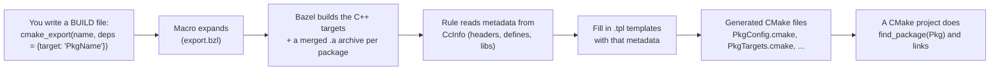
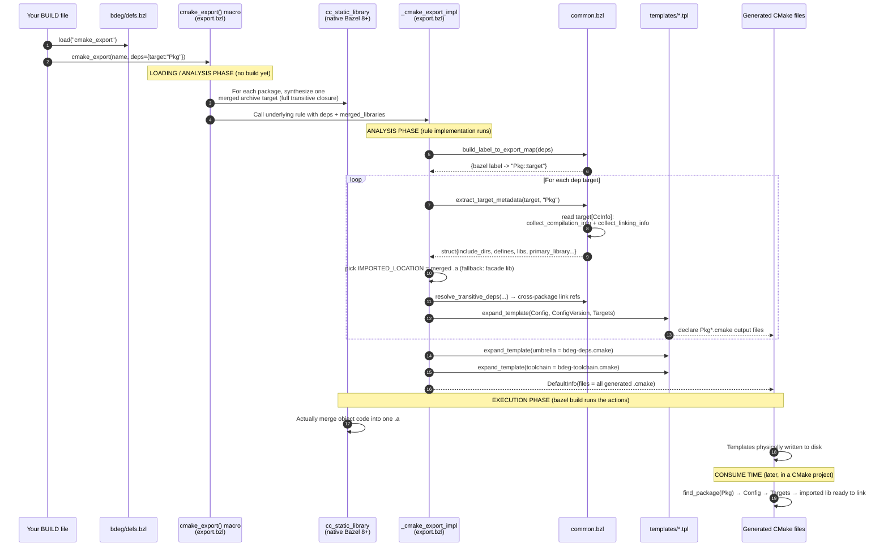
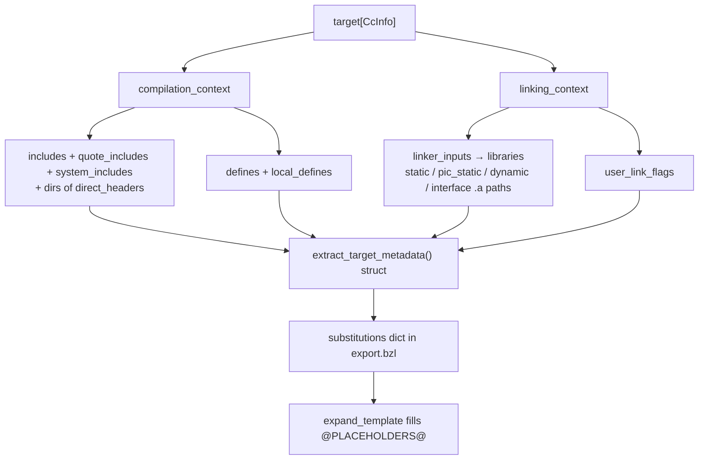
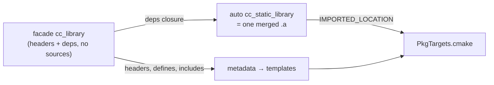

<!-- ----------------------------------------------------------------------------
  Copyright (c) 2026 Contributors to the Eclipse Foundation

  See the NOTICE file(s) distributed with this work for additional
  information regarding copyright ownership.

  This program and the accompanying materials are made available under the
  terms of the Apache License Version 2.0 which is available at
  https://www.apache.org/licenses/LICENSE-2.0

  SPDX-License-Identifier: Apache-2.0
----------------------------------------------------------------------------- -->

# How `rules_bdeg` Works (CMake export)

**BDEG = Bazel Dependency Export Generator.**
Its one job: take a Bazel C++ target and spit out `*Config.cmake` package files, so a
plain CMake project can `find_package(...)` and link against something that was built by Bazel.

This doc explains, in plain language and in time order:
- where the information comes from,
- when the CMake files are generated from templates,
- which method in which file does what.

---

## 1. The 10,000-foot view



Think of it as a translator: **Bazel knows** where the headers, the compiled `.a` files, the
`-D` defines, and the dependency graph are. BDEG copies that knowledge into the file format
**CMake understands**.

---

## 2. Where the files live (map)

```
bdeg/
├── defs.bzl                      ← PUBLIC door. You load cmake_export from here.
└── private/
    ├── common.bzl                ← Format-agnostic brain: reads CcInfo, extracts metadata
    └── cmake/
        ├── export.bzl            ← The CMake macro + rule (the orchestrator)
        └── templates/            ← The blank forms that get filled in
            ├── Config.cmake.tpl         (entry point for find_package)
            ├── ConfigVersion.cmake.tpl  (version check)
            ├── Targets.cmake.tpl         (the real work: imported library + link info)
            ├── umbrella.cmake.tpl        (bdeg-deps.cmake: finds the Bazel roots)
            └── toolchain.cmake.tpl       (C++ standard, PIC, etc.)
```

Rule of thumb:
- `defs.bzl` = the API you call.
- `export.bzl` = the "when/what" orchestration.
- `common.bzl` = the "where does the info come from" extraction.
- `templates/*.tpl` = the "what the output looks like" blank forms.

---

## 3. Time-ordered sequence (what happens, in order)



### The key timing idea

There are **three distinct phases**, and this is usually the confusing part:

1. **Loading phase** — the `cmake_export` *macro* runs. It is just Starlark glue code.
   It creates extra build targets (`cc_static_library`) on the fly, then calls the real rule.
   *Nothing is compiled yet.*
2. **Analysis phase** — `_cmake_export_impl` runs. It reads metadata from the providers
   (`CcInfo`) and calls `ctx.actions.expand_template(...)` to **declare** the output files
   and how to fill them. *Still nothing on disk yet* — it only registers actions.
3. **Execution phase** — when you run `bazel build //examples/gtest_boost:export`,
   Bazel actually compiles the C++, builds the merged `.a`, and writes the filled-in
   `.cmake` files to `bazel-bin/.../cmake-packages/`.

So the CMake files are "created from templates" during analysis (the recipe) and
"materialized" during execution (the cooking).

---

## 4. Where does the information come from?

Everything factual about the C++ target comes from Bazel's **`CcInfo` provider**.
`common.bzl` is the only place that touches it.



| Information | Source field in `CcInfo` | Extracted by |
|---|---|---|
| Include directories | `compilation_context.includes/quote_includes/system_includes` + header dirs | `collect_compilation_info` |
| Compile defines | `compilation_context.defines` + `local_defines` | `collect_compilation_info` |
| Library `.a` paths | `linking_context.linker_inputs[].libraries[]` | `collect_linking_info` |
| Linker flags | `linker_inputs[].user_link_flags` | `collect_linking_info` |
| Cross-package deps | `linker_inputs[].owner` matched against label map | `resolve_transitive_deps` |

The **merged archive path** (the thing CMake actually links) comes from a different place:
the native `cc_static_library` target that the macro synthesized. `export.bzl`'s
`_merged_archive_path()` reads its `DefaultInfo` and grabs the single `.a` file.

---

## 5. Which method does what (cheat sheet)

### `bdeg/defs.bzl`
- Re-exports `cmake_export`. This is the only symbol users load. No logic.

### `bdeg/private/cmake/export.bzl`
| Function | Role |
|---|---|
| `cmake_export(name, deps, ...)` | **Macro / entry point.** For each package, creates a merged `cc_static_library` (full transitive closure, `-symbol_check`), then calls the real rule. Accepts `whole_archive` (all packages) and `whole_archive_packages` (per package) to control whole-archive linking. |
| `_cmake_export_rule` | The actual Bazel `rule` definition (attributes: `deps`, `merged_libraries`, `version`, template labels, etc.). |
| `_cmake_export_impl(ctx)` | **The orchestrator.** Loops over deps, pulls metadata, chooses `IMPORTED_LOCATION`, resolves transitive deps, and calls `expand_template` for every output file. |
| `_cmake_target_name()` | Formats `Package::target`. |
| `_merged_archive_path()` | Finds the single `.a` produced by the merged target. |
| `_render_cmake_target_properties()` | Builds the substitution values (include dirs, link libs, defines) for the Targets template. |

### `bdeg/private/common.bzl` (format-agnostic)
| Function | Role |
|---|---|
| `extract_target_metadata()` | Main entry: returns a struct with name, includes, defines, libs, primary_library. |
| `collect_compilation_info()` | Pulls include dirs + defines from the compilation context. |
| `collect_linking_info()` | Pulls library paths + link flags from the linking context. Uses `select_library_file` so PIC archives are preferred when both variants exist. |
| `select_library_file()` | Picks one file for a `LibraryToLink` that may carry several variants (`.a`, `.pic.a`, dynamic, interface). Prefers the PIC static archive by default (Bazel's dominant build mode), like rules_foreign_cc keeping both variants and letting the toolchain choose. |
| `resolve_transitive_deps()` | Maps transitive libs back to other exported `Pkg::target` names. With `drop_own_leaf_objects=True` (set when a merged archive is exported) it drops only *unmapped* paths under `bazel-out/` — this package's own leaf objects, already inside the merged `.a` — to avoid double-linking. Unmapped paths **not** under `bazel-out/` (genuine external/system libs like a prebuilt `libacl.a`) are kept, since the merged archive does not contain them. Cross-package references are always kept. |
| `build_label_to_export_map()` | Builds `{bazel label -> Pkg::target}` so deps between packages can cross-reference. |
| `sanitize_identifier()` / `unique_strings()` | Small helpers (valid names, dedup). |

### `bdeg/private/cmake/templates/*.tpl`
| Template | Produces | Purpose |
|---|---|---|
| `Config.cmake.tpl` | `PkgConfig.cmake` | What `find_package(Pkg)` loads first; sets `Pkg_FOUND` and includes Targets. |
| `ConfigVersion.cmake.tpl` | `PkgConfigVersion.cmake` | Version compatibility check. |
| `Targets.cmake.tpl` | `PkgTargets.cmake` | **The important one.** Declares the `IMPORTED` library, resolves relative Bazel paths to absolute by trying **both** `BDEG_EXECROOT` and `BDEG_OUTPUT_BASE` (via `_bdeg_resolve_path`) so either repo layout works, sets include dirs, link libraries, and whole-archive handling. When a library can't be found, `_bdeg_report_missing_library` emits a precise warning: "not built yet" (its directory exists) vs "path could not be resolved" (its directory is missing). |
| `umbrella.cmake.tpl` | `bdeg-deps.cmake` | Umbrella include; **computes `BDEG_EXECROOT`** (walks up to find `bazel-out`) **and `BDEG_OUTPUT_BASE`** (strips the `execroot/<workspace>` tail) so external repos can be found under either the legacy or the sibling layout, then includes every package's Config. |
| `toolchain.cmake.tpl` | `bdeg-toolchain.cmake` | Sets C++ standard, PIC, `compile_commands.json`, etc. |

---

## 6. The merged-archive trick (why it exists)

A facade `cc_library` often owns **no source code** — only `deps`. If BDEG exported just that
facade's own (empty) archive, a CMake consumer would hit "undefined reference" errors because
the real object code lives in the leaf dependencies.

So the macro auto-creates a `cc_static_library` that **merges the whole transitive closure
into one `.a`**. CMake then imports that single self-contained archive.



- `whole_archive = False` (default): import the merged `.a` as a normal `STATIC` library.
  The merged archive already holds the full closure, so normal archive semantics resolve
  every referenced symbol while dropping unused objects.
- `whole_archive = True` (opt-in, **all** packages): force **every** object in with
  `--whole-archive` plus `--allow-multiple-definition`. Only needed for static-init side
  effects, plugin registries, or `dlopen`'d symbols.
- `whole_archive_packages = ["Pkg", ...]` (opt-in, **per package**): whole-archive only the
  named packages, leaving the rest as normal `STATIC`. This mirrors rules_foreign_cc's
  per-target `alwayslink`, at package granularity (one `cmake_export` call declares many
  packages). Use it when one component must be whole-archived but another must **not** be —
  e.g. a package that already subsumes a dependency's objects, where whole-archiving both
  would double-link and cause multiple-definition errors.

---

## 7. End-to-end example

Given this BUILD file (`examples/gtest_boost/BUILD.bazel`):

```python
load("@rules_bdeg//bdeg:defs.bzl", "cmake_export")

cmake_export(
    name = "export",
    deps = {
        "@googletest//:gtest": "GTest",
        "@googletest//:gtest_main": "GTestMain",
        "@boost.program_options": "Boost",
    },
    output_dir = "cmake-packages",
    version = "1.0.0",
)
```

Running `bazel build //examples/gtest_boost:export` produces, under
`bazel-bin/examples/gtest_boost/cmake-packages/`:

```
GTestConfig.cmake        GTestConfigVersion.cmake        GTestTargets.cmake
GTestMainConfig.cmake    GTestMainConfigVersion.cmake    GTestMainTargets.cmake
BoostConfig.cmake        BoostConfigVersion.cmake        BoostTargets.cmake
bdeg-deps.cmake          bdeg-toolchain.cmake
```

A CMake project then does:

```cmake
include(".../cmake-packages/bdeg-deps.cmake")   # sets BDEG_EXECROOT + BDEG_OUTPUT_BASE, includes all configs
find_package(GTest REQUIRED)
target_link_libraries(my_test PRIVATE GTest::GTest GTestMain::GTestMain)
```

...and links against the Bazel-built, fully-merged archives.
```
